<div align="center">

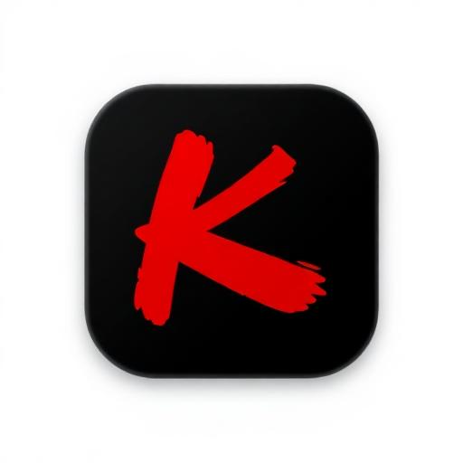

# KuroToon

### Every source. Every soundtrack. One beautifully simple home.

The manga, manhwa and webtoon reader for Android that plays the music, remembers the panels you love<br>
and tells you what's out today. Private by default: no accounts, no ads, no tracking.

[](https://github.com/FAHTHIZ/Kurotoon/actions/workflows/build.yml)
[](https://github.com/FAHTHIZ/Kurotoon/releases/latest)
[](LICENSE)


**[Download](https://github.com/FAHTHIZ/Kurotoon/releases/latest)** ·
**[Tour](#a-quick-tour)** ·
**[Features](#everything-it-does)** ·
**[Design](#designed-not-reskinned)** ·
**[Compare](#how-it-compares)** ·
**[Get started](#get-started)** ·
**[Guides](docs/)**

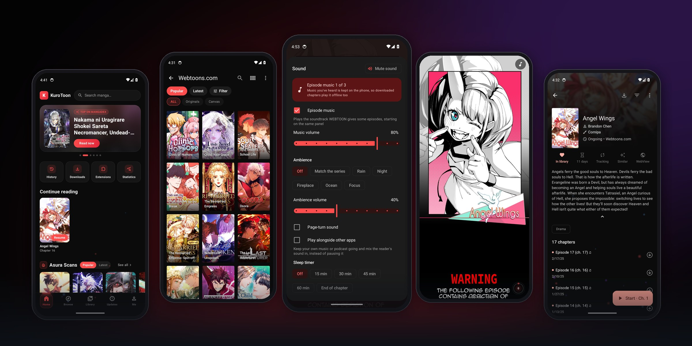

<sub>Every picture on this page is a real screenshot of the current build, taken on an Android emulator with the
Webtoons.com, MangaDex and Asura Scans sources installed from a public extension store.</sub>

</div>

## Why KuroToon

Open-source readers give you every source and your privacy. Webtoon apps give you a home feed, a release
calendar and music while you read. KuroToon is the first to give you both, plus things neither has:

- **The soundtrack plays.** WEBTOON episodes with BGM play their music in KuroToon, starting and stopping on the
  same panels as the official app. Every other chapter can get rain, night, fireplace, ocean or focus ambience.
- **It knows when to stop.** A sleep timer winds the session down after 15 to 60 minutes or at the end of the
  chapter: auto-scroll stops, the music fades and a dim "Time to rest" card takes over.
- **It keeps what you love.** Long-press any page and **Keep panel**. Your saved panels live in a gallery that
  jumps straight back to the chapter.
- **It's kind to your data plan.** Data saver shrinks pages to WebP on mobile data (or always), with a quality
  slider and automatic fallback for sites that refuse it.
- **It feels alive.** A Home feed, a weekly release schedule, a Continue reading widget, a daily goal, a year in
  review and a shop you fill by reading, never by paying.

## A quick tour

<div align="center">

| Home | Browse a source | Series page |
| :---: | :---: | :---: |
| 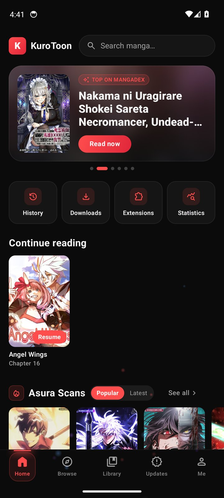 | 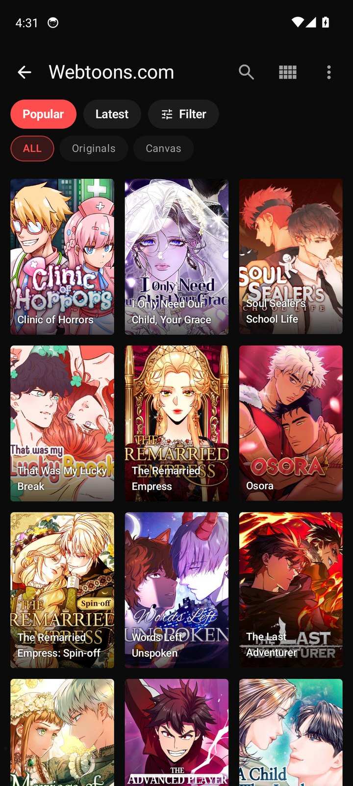 | 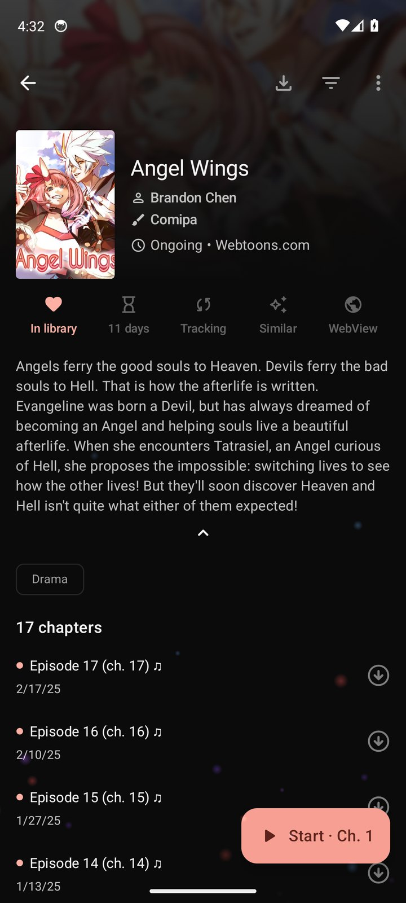 |
| **Episode music playing** | **Reader menu** | **Soundtrack and sleep timer** |
| 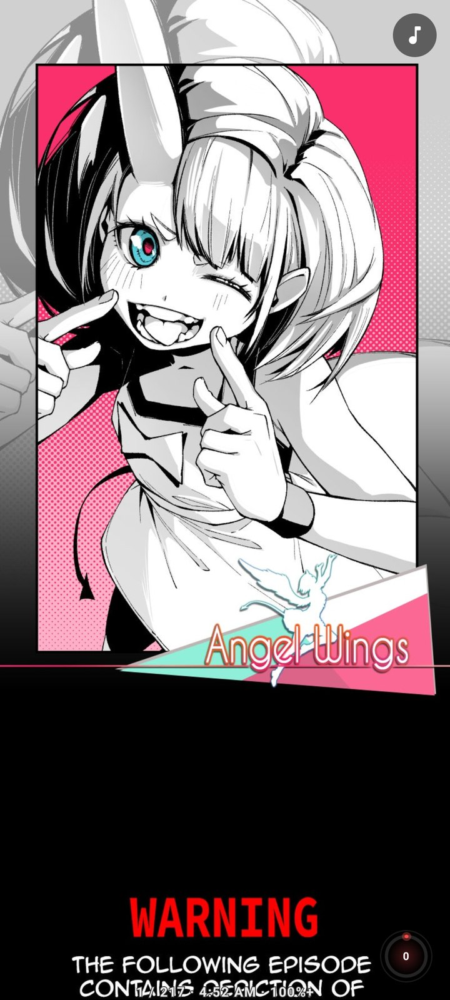 | 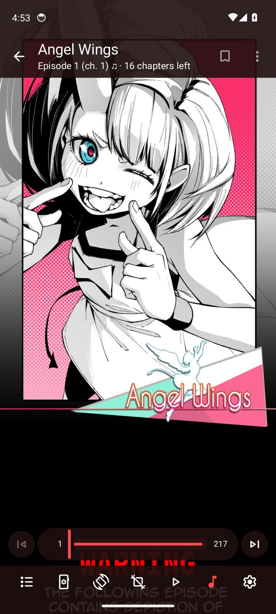 | 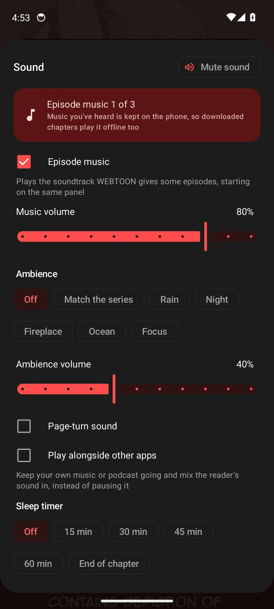 |
| **Keep a panel** | **Long-strip reading** | **Continue reading** |
| 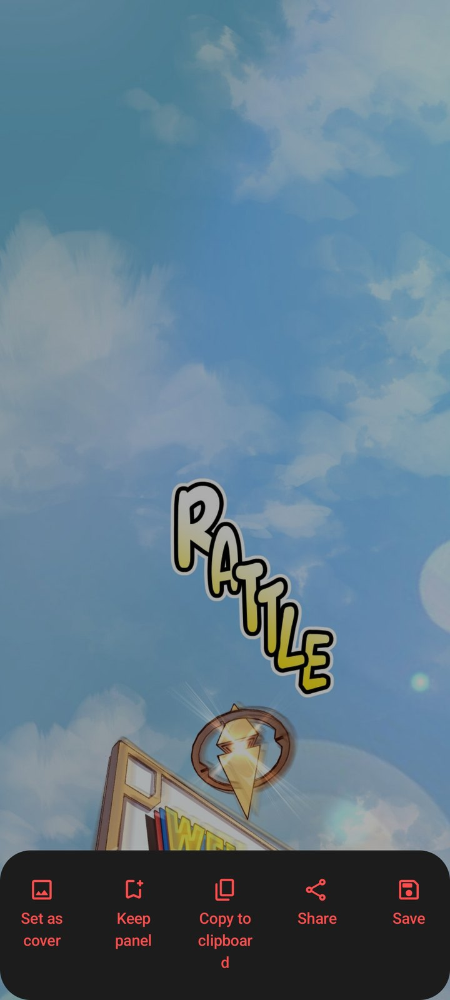 | 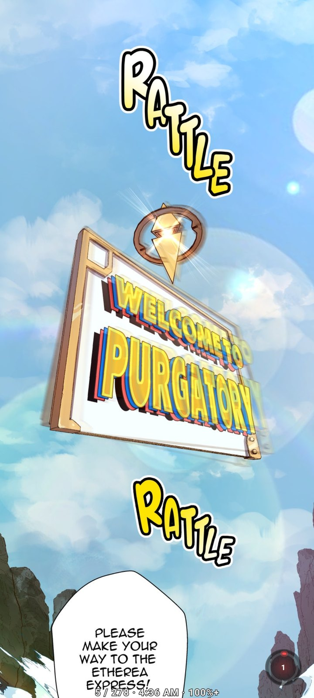 | 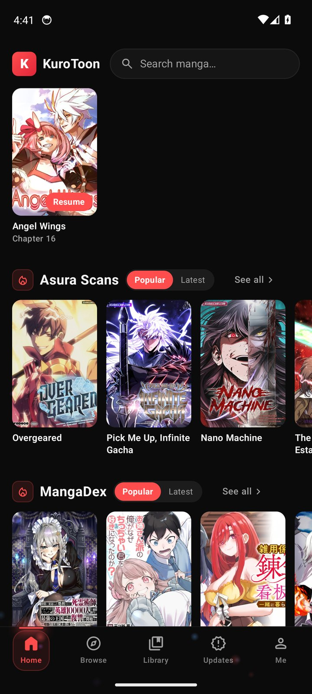 |
| **Library** | **Updates** | **Me** |
| 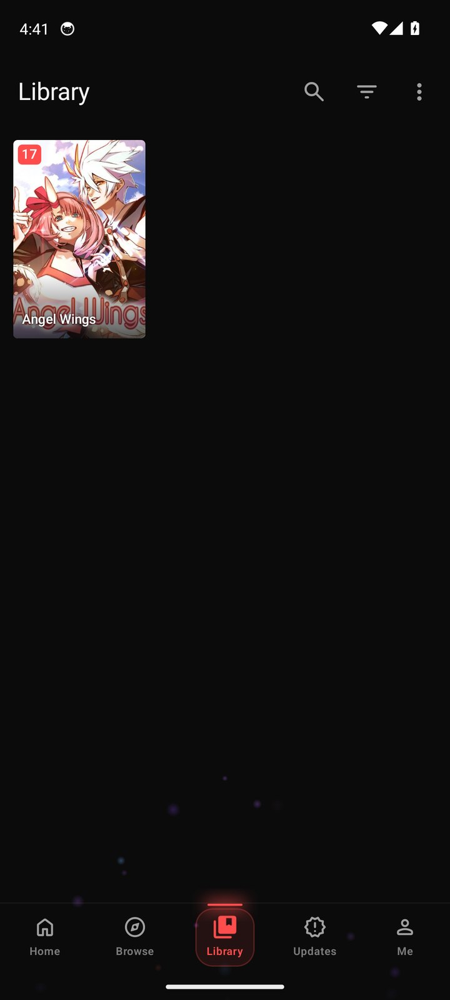 | 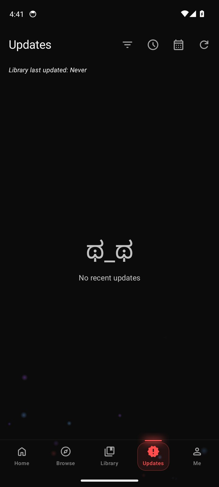 | 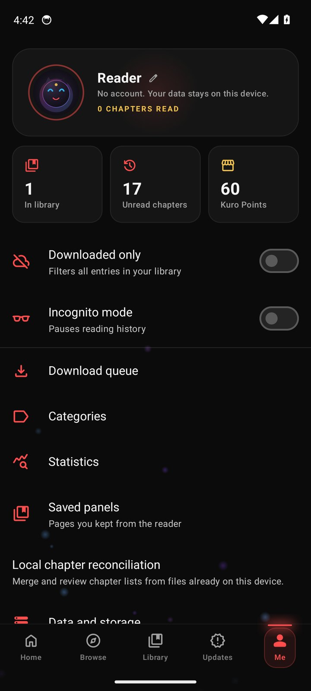 |
| **Kuro Points shop** | **Statistics** | **Knows the release days** |
| 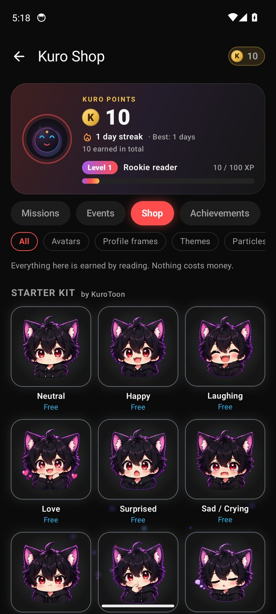 | 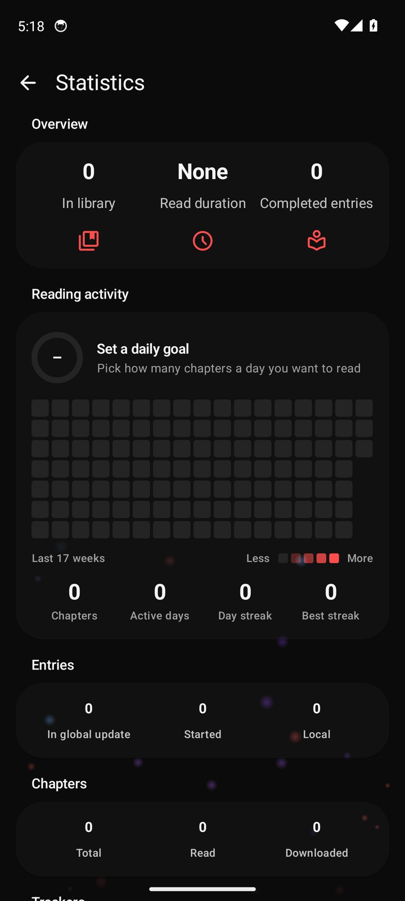 | 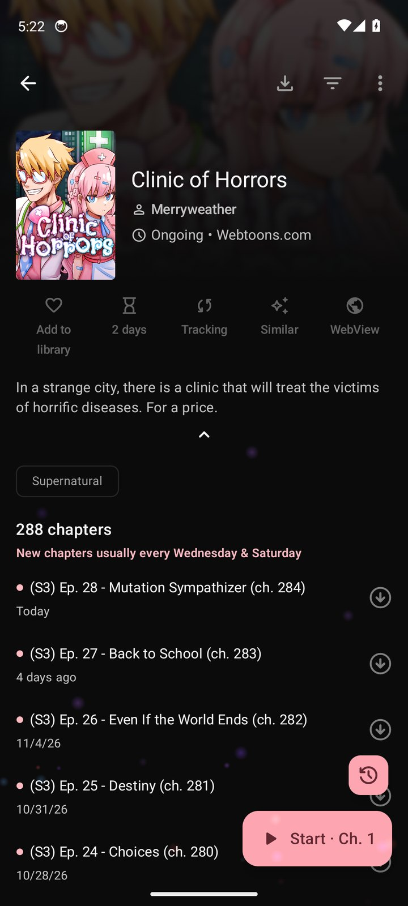 |
| **Sources** | **Extensions** | **First run** |
| 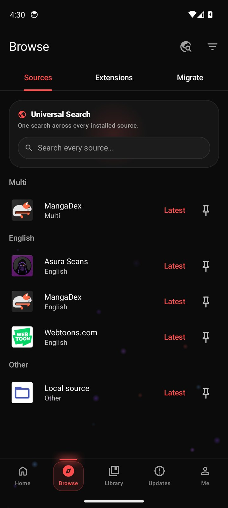 | 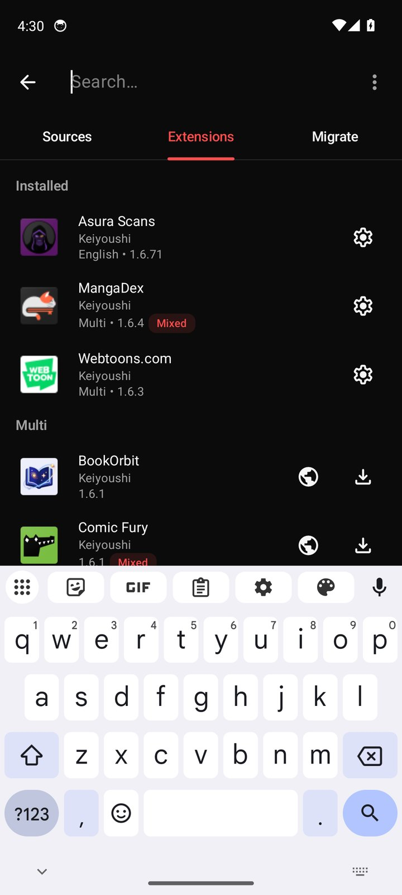 | 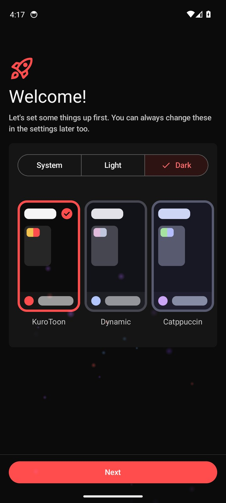 |

</div>

## Everything it does

<table>
<tr>
<td width="33%" valign="top">

#### Read
- Webtoon (long strip) and paged modes, picked automatically for manhwa and webtoons
- **Soundtrack**: WEBTOON BGM, generated ambience, page-turn sound
- **Sleep timer** with a gentle wind-down
- Hands-free **auto-scroll** with ten speeds
- Per-series ambience memory, crossfading tracks, offline music for downloads
- Chapter list inside the reader, progress orb, time left in the chapter
- Reopens long strips on the exact panel; go to any page; clock and battery on screen
- **Bedtime warmth** that eases pages warmer and dimmer at night
- **Keep panel**, save, share or set any page as the cover
- **Data saver** with a quality slider
- A small celebration when you finish a chapter

</td>
<td width="33%" valign="top">

#### Discover
- Home: hero carousel, Continue reading, New chapters, **Out today**, "Because you read…" and rows per source
- **Weekly release schedule** learned from your library
- Every source's own genres and themes as one-tap tags; long-press to exclude
- **Saved searches** you can pin to Home
- Universal search across every source
- **More like this** from AniList recommendations

</td>
<td width="33%" valign="top">

#### Keep
- Library grouped by category, source or status, with **hidden categories**
- Progress bars and source badges on covers
- **Edit info**: your own title, people, tags and description that survive refreshes
- Duplicates finder, bulk add, random pick
- Offline downloads, backups, source migration
- Tracker sync: AniList, MyAnimeList, Kitsu, MangaUpdates and more

</td>
</tr>
<tr>
<td valign="top">

#### Make it yours
- Crimson-on-black KuroToon theme, dynamic colour and more
- Series pages tinted by their cover
- Avatars, animated frames, particle colours and badges from the **Kuro Shop**
- Import your own [`.kpack` files](docs/shop-packs.md)

</td>
<td valign="top">

#### Build a habit
- Daily goal and an optional reminder at your hour
- Kuro Points, daily missions and achievements
- Reading heatmap, pace and **year in review**
- **Continue reading** home-screen widget
- **Your panels** row on Home

</td>
<td valign="top">

#### Stay private
- No accounts, no analytics, no ads
- Library, history and downloads stay on the phone
- Incognito mode
- Backups are plain files you own
- Extension stores you add yourself and can switch off

</td>
</tr>
</table>

## Designed, not reskinned

KuroToon started from Mihon's engine (sources, downloads, backups, trackers) and keeps it. The screens on top are
its own: one design language of rounded cards, accent section headers, pills and a crimson-on-black palette.

| Screen | Mihon | KuroToon |
| --- | --- | --- |
| Home | Not there; opens on Library | Hero carousel, Continue reading, Out today, Because you read, your panels |
| Library | Tabs and a filter sheet | Category pills, one-tap quick filters, rounded covers, list mode as cards |
| Updates | Plain dated list | Status card, day headers, NEW badges, release schedule |
| History | Plain rows | Cards with a Resume pill and progress |
| Browse | List rows | Source and extension cards with Popular, Latest, Install and Update pills |
| Global search | Spinner per source | Accent headers, See all pills, pulsing cover placeholders |
| Series page | Icon-and-label buttons, outlined chips | Rounded action tiles, tag pills, a read progress bar, accent rail on unread chapters |
| Reader | Full-width bars | Floating rounded dock, soundtrack badge, sleep timer, progress orb |
| Me and Settings | Flat preference lists | Mode tiles and grouped cards with colored icons, settings search bar |
| Empty screens | Kaomoji | A sleeping Kuro |
| Settings sheets | Underlined tab rows | Segmented pill tabs |
| About | Logo and a list | Kuro, the tagline and a version pill above grouped cards |
| Downloads | A plain queue | A summary card with Kuro and live progress, chapters as cards with rounded progress bars |
| Migration | Bare rows | Source cards for picking, and each old-to-new pair in one card |
| Tracker search | Grey result boxes | Rounded cards with a crimson outline on the pick |
| Feature discovery | None | A Home tip card where Kuro shows off one KuroToon feature at a time |

Details for each redesign are in the [changelog](CHANGELOG.md).

## How it compares

KuroToon is built on Mihon and keeps everything that makes it great. Here is how it stacks up against the
readers people usually switch from.

| | **KuroToon** | Mihon | TachiyomiSY | Komikku | Kotatsu | WEBTOON |
| --- | :---: | :---: | :---: | :---: | :---: | :---: |
| Any source through extensions | ✅ | ✅ | ✅ | ✅ | ✅ | ❌ |
| No account, ads or analytics | ✅ | ✅ | ✅ | ✅ | ✅ | ❌ |
| Downloads, backups, trackers | ✅ | ✅ | ✅ | ✅ | ✅ | ➖ |
| Episode music (BGM) | ✅ | ❌ | ❌ | ❌ | ❌ | ✅ |
| Reading ambience and sleep timer | ✅ | ❌ | ❌ | ❌ | ❌ | ❌ |
| Saved panels gallery | ✅ | ❌ | ❌ | ❌ | ❌ | ❌ |
| Home feed with Continue reading | ✅ | ❌ | ➖ feed | ✅ feed | ➖ | ✅ |
| Weekly schedule and "Out today" | ✅ | ➖ upcoming | ➖ upcoming | ➖ upcoming | ❌ | ✅ |
| Auto-scroll | ✅ | ❌ | ✅ | ✅ | ✅ | ❌ |
| Data saver | ✅ | ❌ | ❌ | ❌ | ✅ | ➖ |
| Edit series info | ✅ | ❌ | ✅ | ✅ | ❌ | ❌ |
| Hidden categories | ✅ | ❌ | ❌ | ✅ | ❌ | ❌ |
| Continue reading widget | ✅ | ➖ updates | ➖ updates | ➖ updates | ✅ | ✅ |
| Daily goal, stats, year in review | ✅ | ➖ stats | ➖ stats | ➖ stats | ➖ stats | ❌ |
| Rewards earned by reading | ✅ | ❌ | ❌ | ❌ | ❌ | ❌ paid coins |

<sub>✅ yes · ➖ partly · ❌ no. Based on each project's public features and changelogs in November 2026:
[Mihon](https://mihon.app/changelogs/), [TachiyomiSY](https://github.com/jobobby04/TachiyomiSY),
[Komikku](https://github.com/komikku-app/komikku), [Kotatsu](https://github.com/KotatsuApp/Kotatsu),
[WEBTOON](https://www.webtoons.com/). Spotted a mistake? Open an issue.</sub>

## Get started

1. **Install.** Grab the APK from the [latest release](https://github.com/FAHTHIZ/Kurotoon/releases/latest), or
   from the newest [Actions run](https://github.com/FAHTHIZ/Kurotoon/actions/workflows/build.yml). Most phones want
   `arm64-v8a`; `universal` works everywhere.
2. **Set up.** Pick a theme, choose (or create) a folder for downloads and backups, grant the permissions you want.
3. **Add an extension store.** Open a `tachiyomi://add-repo?url=…` link, or go to **Browse → Extensions →
   menu → Extension stores → Add** and paste the store's `index.min.json` URL.
4. **Install sources**, find a series and tap **Add to library**, or long-press any cover.
5. **Read.** Tap the middle of the page for the menu; the music note opens the soundtrack and sleep timer.

The [guides](docs/) cover [getting started](docs/getting-started.md), [your library](docs/library.md),
[tracking](docs/tracking.md), [storage](docs/storage.md), [moving between sources](docs/source-migration.md),
[privacy](docs/privacy.md) and [troubleshooting](docs/troubleshooting.md). To check every feature yourself, follow
[Try every feature](docs/testing.md), a 20-minute walkthrough with a checkbox per step.

## Reader tips

- **Play** in the bottom bar starts auto-scroll; touching the screen pauses it.
- The **music note** opens the Sound sheet: episode music, ambience, page-turn sound and the sleep timer.
- **Long-press a page** to keep the panel, save, share or set it as the cover.
- The **list button** shows every chapter; jump to any of them.
- Volume keys turn pages, or change the auto-scroll speed while it runs.
- **Settings → General → Data saver** shrinks pages on mobile data.

## Development

Requirements: JDK 21 and the Android SDK.

```sh
./gradlew assembleDebug                 # debug APK in app/build/outputs/apk/debug/
./gradlew assembleRelease               # release APKs (debug-signed unless keystore.properties exists)
./gradlew spotlessApply                 # format
./gradlew :app:testDebugUnitTest        # unit tests
```

Every push to `main` is built by GitHub Actions and the APK is attached to the run. The **QA emulator** workflows
boot an Android emulator and walk through real user journeys (first run, adding a store, installing sources,
browsing, reading), recording a screenshot of every step; that's where the pictures above come from. Pushing a
`v*` tag publishes a release with per-ABI APKs and checksums. Add the `SIGNING_KEY` (base64 keystore), `ALIAS`,
`KEY_STORE_PASSWORD` and `KEY_PASSWORD` secrets to sign them with your own key.

## License

KuroToon is distributed under the Apache License 2.0. It is built on [Mihon](https://github.com/mihonapp/mihon)
and other Apache-2.0 open-source Android readers; their copyright notices are kept in the source files. See
[LICENSE](LICENSE). KuroToon ships with no content; sources come from extension stores you choose to add.
