<div align="center">

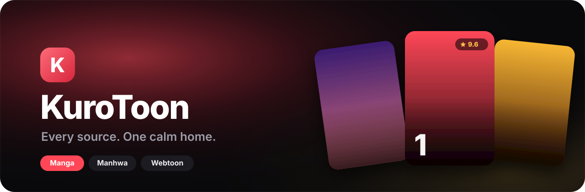

<br>

A manga, manhwa and webtoon reader for Android that puts the series you're reading first,<br>
plays the episode music, and never asks for an account, a coin or a wait.

<br>

[](https://github.com/FAHTHIZ/Kurotoon/releases/latest)
&nbsp;
[](https://github.com/FAHTHIZ/Kurotoon/actions)
&nbsp;
[](LICENSE)

[Why](#why-kurotoon) &nbsp;·&nbsp; [Screens](#screens) &nbsp;·&nbsp; [Features](#features) &nbsp;·&nbsp; [Design](#design) &nbsp;·&nbsp;
[Compare](#how-it-compares) &nbsp;·&nbsp; [Install](#install) &nbsp;·&nbsp; [Guides](docs/) &nbsp;·&nbsp;
[Changelog](CHANGELOG.md)

<sub>Android 8.0+ &nbsp;·&nbsp; Kotlin and Jetpack Compose &nbsp;·&nbsp; Apache-2.0 &nbsp;·&nbsp; No ads, accounts or analytics</sub>

</div>

<br>

> [!NOTE]
> KuroToon ships with no content. You add the extension stores and sources you want, and everything you read,
> save and download stays on your phone.

<br>

## Why KuroToon

Readers of the big official apps keep asking for the same things: show me **my series first**, tell me **what's
out today**, keep the **big artwork**, and stop burying chapters under coins, timers and promo rows. Open-source
readers already give you every source and your privacy, but they open on a plain grid.

KuroToon is both halves in one app.

<table>
<tr>
<td width="50%" valign="top">

**Your series first**<br>
Home opens on an *Up next* card for the series you read last, with one Resume button, then the rest of what
you're reading, new chapters and what's due today. Discovery comes after.

</td>
<td width="50%" valign="top">

**One catalogue, many sources**<br>
Search every installed source at once. The same series found on several sites shows once, and its chapters merge
into one list, so 1–4 from one site and 5–7 from another read as 1–7.

</td>
</tr>
<tr>
<td valign="top">

**The soundtrack plays**<br>
WEBTOON episodes with background music play it on the same panels as the official app. Any other chapter can get
rain, night, fireplace, ocean or focus ambience, with a sleep timer that winds things down.

</td>
<td valign="top">

**Nothing to pay, nothing to wait for**<br>
No coins, no daily passes, no streak chests. The Collection of avatars, frames, stickers and themes is free. Tap
one, tap Use.

</td>
</tr>
</table>

<br>

## Screens

<table>
<tr>
<td width="33%" valign="top">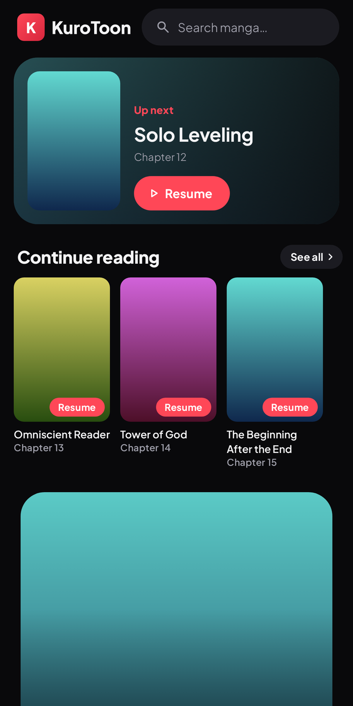<br><sub><b>Home</b> · your series first</sub></td>
<td width="33%" valign="top">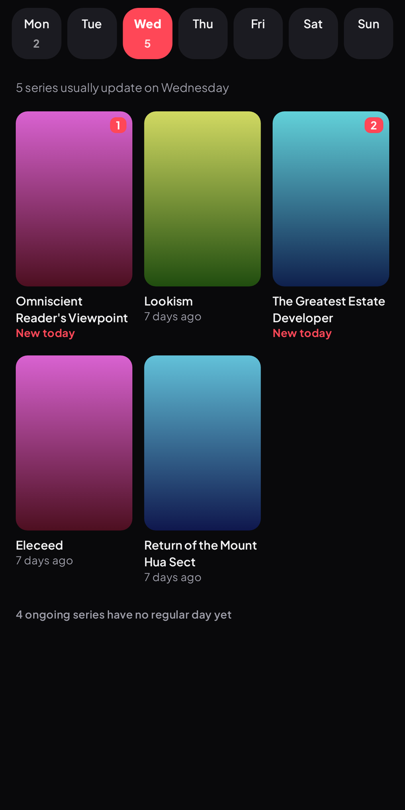<br><sub><b>Schedule</b> · what's out each day</sub></td>
<td width="33%" valign="top">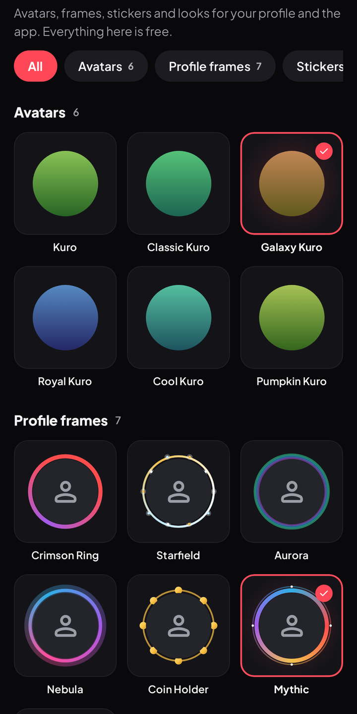<br><sub><b>Collection</b> · free looks, no coins</sub></td>
</tr>
</table>

<table>
<tr>
<td width="50%" valign="top">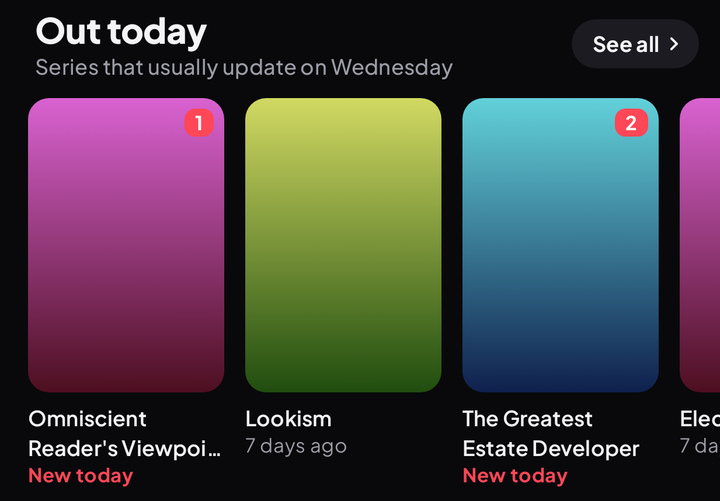<br><sub><b>Out today</b> · what your library releases today</sub></td>
<td width="50%" valign="top">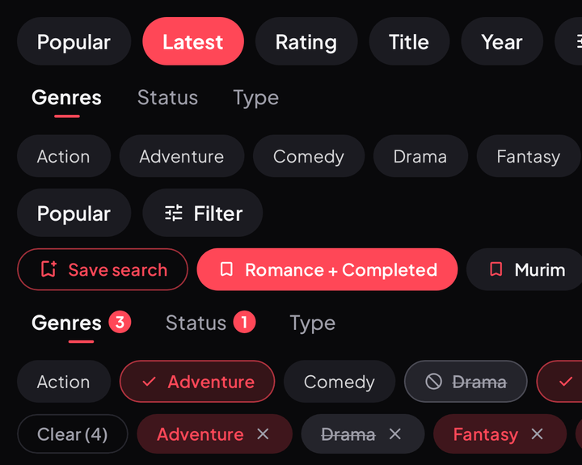<br><sub><b>Browse</b> · sort pills and tags from the source</sub></td>
</tr>
<tr>
<td valign="top">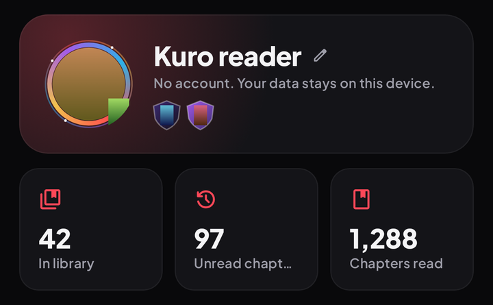<br><sub><b>Me</b> · your reading, on your phone</sub></td>
<td valign="top">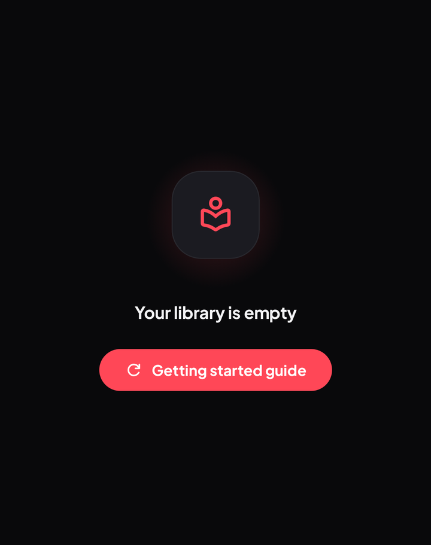<br><sub><b>Empty screens</b> · one helpful line and a way forward</sub></td>
</tr>
</table>

<table>
<tr>
<td width="50%" valign="top">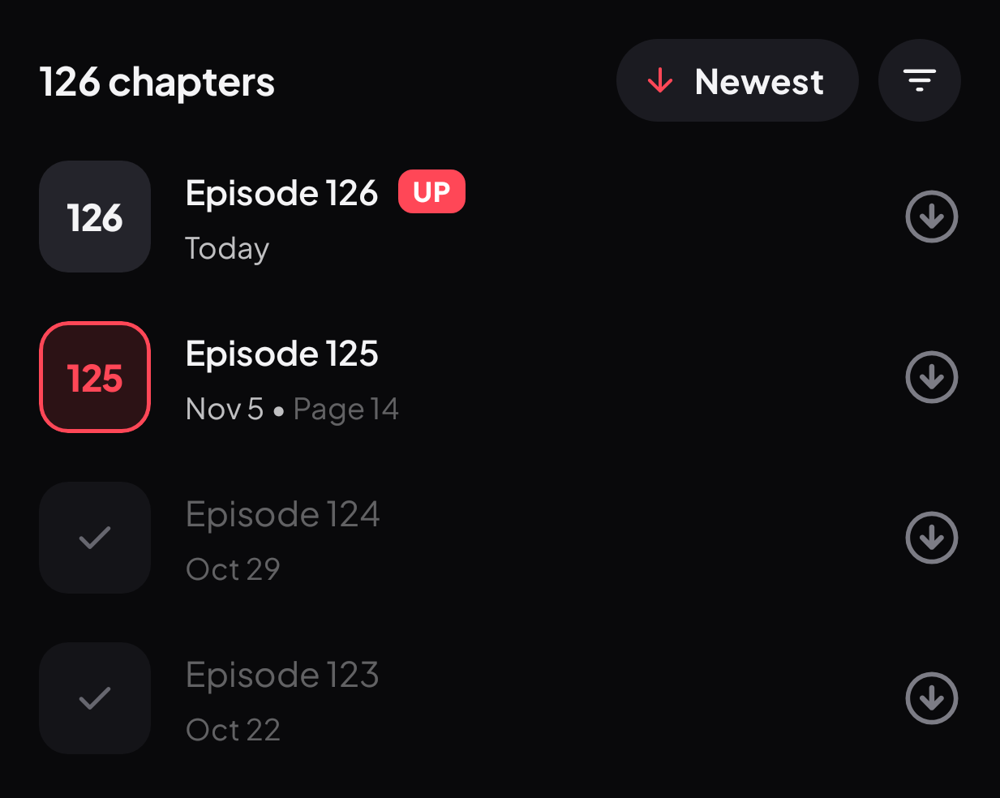<br><sub><b>Episodes</b> · numbered tiles, new ones marked UP</sub></td>
<td width="50%" valign="top">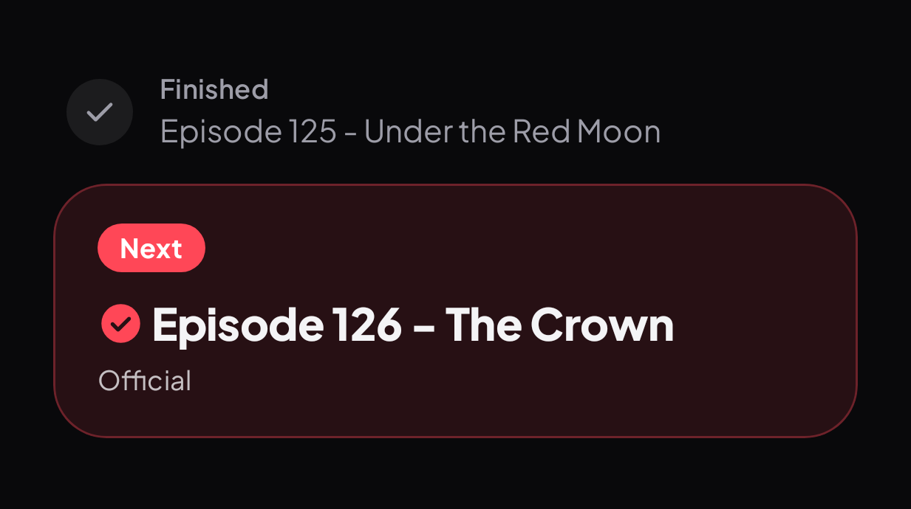<br><sub><b>Up next</b> · a calm card between episodes</sub></td>
</tr>
</table>

<table>
<tr>
<td width="50%" valign="top">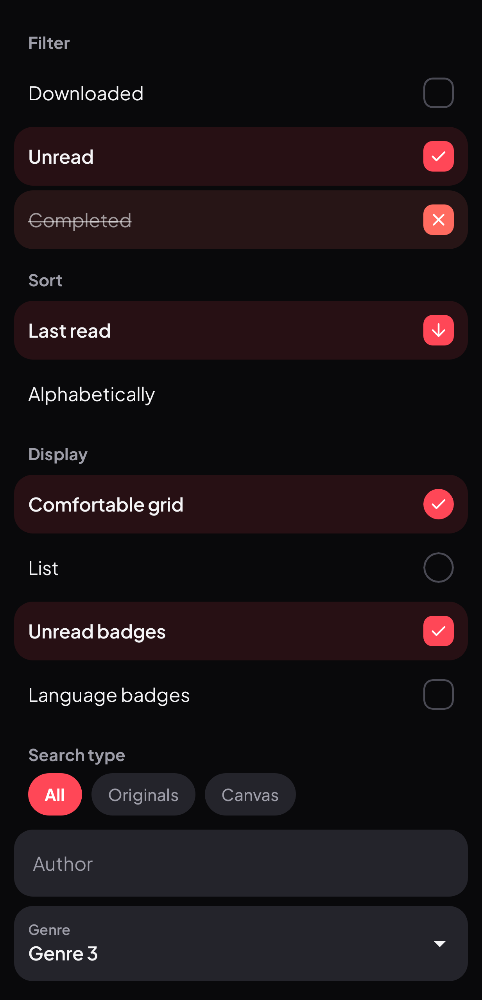<br><sub><b>Sheets</b> · on, only, hide at a glance</sub></td>
<td width="50%" valign="top">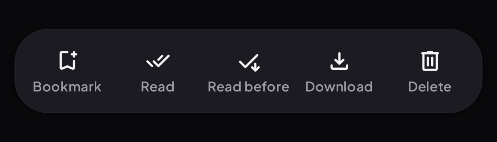<br><sub><b>Selection</b> · a labelled floating dock</sub></td>
</tr>
</table>

<table>
<tr>
<td width="33%" valign="top">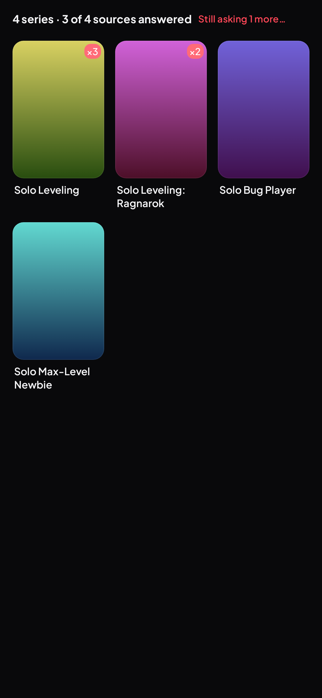<br><sub><b>Universal search</b> · one merged grid, each series once</sub></td>
<td width="33%" valign="top">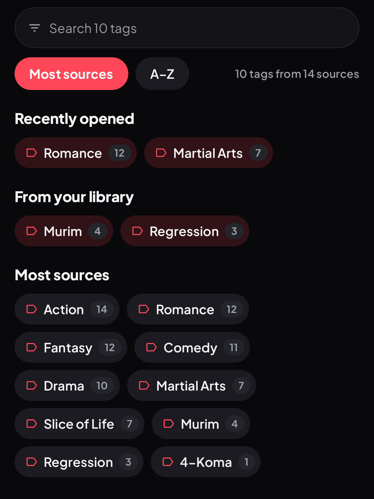<br><sub><b>Tags</b> · every tag from every source</sub></td>
<td width="33%" valign="top">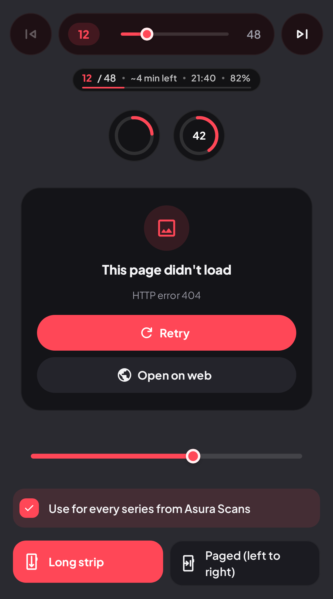<br><sub><b>Reader</b> · slider, page capsule, loader, error card</sub></td>
</tr>
</table>

<p align="center">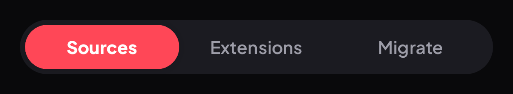</p>

<p align="center">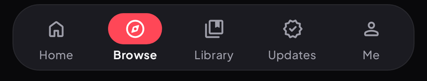</p>

<sub>Rendered from the real Compose screens with Roborazzi, using placeholder gradient covers.</sub>

<br>

## Features

<details open>
<summary><b>Read</b></summary>

<br>

- Long strip and paged modes, picked automatically for webtoons and manhwa
- Episode music (WEBTOON BGM), generated ambience and an optional page-turn sound
- Sleep timer for 15 to 60 minutes or the end of the chapter, with a gentle fade
- Hands-free auto-scroll with ten speeds; volume keys change the speed
- Reopens long strips on the exact panel; jump to any page or chapter from the reader
- Bedtime warmth that eases pages warmer and dimmer at night
- Long-press any page to keep the panel, save, share or set it as the cover
- Data saver that shrinks pages to WebP on mobile data, with a quality slider
- At the end of a chapter, the next one from whichever source has it

</details>

<details open>
<summary><b>Discover</b></summary>

<br>

- Home in the order readers asked for: Up next, Continue reading, New chapters, Due today, then a featured banner
  and a row per source
- Weekly release schedule learned from your library
- Universal search across every source, each series shown once with a ×N badge
- Tags gathered from every installed source, merged and filtered as you type; long-press a tag to hide it
- Saved searches you can pin to Home
- *More like this* from AniList recommendations

</details>

<details open>
<summary><b>Keep</b></summary>

<br>

- Library by category, source or status, with hidden categories and one-tap quick filters
- A series saved from several sources shows once, led by the copy you read last
- **Merged chapters** across sources ([how it works](docs/merged-chapters.md))
- One-shots labelled on the series page, with their own filter
- Edit a series' title, people, tags and description; your edits survive refreshes
- Duplicates finder, bulk add, random pick
- Offline downloads, backups you own, source migration
- Tracking with AniList, MyAnimeList, Kitsu, MangaUpdates and more

</details>

<details>
<summary><b>Make it yours</b></summary>

<br>

- Dark KuroToon theme, dynamic colour and more, with one accent colour throughout
- Series pages tinted by their cover
- Choose which Home sections show
- Free Collection: avatars, profile frames, stickers, badges and themes; share stickers in chats
- Import your own [`.kpack` packs](docs/shop-packs.md)

</details>

<details>
<summary><b>Build a habit</b></summary>

<br>

- Daily goal with an optional reminder at your hour
- Reading heatmap, pace and a year in review
- Continue reading home-screen widget
- A gallery of the panels you kept

</details>

<details>
<summary><b>Stay private</b></summary>

<br>

- No accounts, analytics or ads
- Library, history and downloads stay on the phone
- Incognito mode
- 18+ sources stay hidden until you allow them behind your device lock
- Extension stores are ones you add yourself

</details>

<br>

## Design

KuroToon's engine (sources, downloads, backups, trackers) grew out of Mihon and stays compatible with its extensions
and backups; everything you see and touch is KuroToon's own design language.

|                       | Principle                                                                                      |
| --------------------- | ---------------------------------------------------------------------------------------------- |
| **Content first**     | Covers and artwork carry the colour. Chrome is ink-black with hairline edges, never loud        |
| **One accent**        | A single crimson marks what's actionable and what's new. It follows the Collection theme you pick |
| **Physical motion**   | Covers and buttons squish when pressed and spring back; shelves cascade in; tabs pop. Never confetti |
| **Your order**        | What you're reading beats what's promoted, on every screen                                     |
| **Quiet copy**        | Sentence-case titles, one helpful line per empty screen, no mascots in everyday views           |

<details>
<summary><b>Design tokens</b></summary>

<br>

| Token | Value |
| --- | --- |
| Typeface | [Plus Jakarta Sans](https://github.com/tokotype/PlusJakartaSans) (SIL OFL 1.1, [licence](docs/licenses/PlusJakartaSans-OFL.txt)), ExtraBold display with tight tracking |
| Background | `#09090B` ink, surfaces stepping up `#0F0F12` → `#24242B` |
| Accent | Crimson `#FF4757` (light theme `#D7263D`), gold `#FFC548` for ratings |
| Shapes | 8 / 12 / 16 / 22 / 28 dp corners; covers 14 dp, hero cards 28 dp |
| Navigation | A floating 64 dp dock; the open tab sits in a solid accent pill that springs wider |
| Motion | Press scale 0.95 with a damped spring, 45 ms stagger for shelves, 1.3 s shimmer for loading |

</details>

<details>
<summary><b>Screen by screen, compared with Mihon</b></summary>

<br>

| Screen | Mihon | KuroToon |
| --- | --- | --- |
| Home | Not there; opens on Library | Up next card, your shelves, then a featured banner and source rows |
| Library | Tabs and a filter sheet | Category pills, quick filters, rounded covers, combined copies |
| Updates | Plain dated list | Day headers, NEW pills, a day-pill release schedule |
| Browse | List rows | Universal search, merged tags, source and extension cards |
| Series page | Icon-and-label buttons | Poster cover over a blurred backdrop, action tiles, tag pills, merged chapter list |
| Reader | Full-width bars | Floating dock, soundtrack, sleep timer, progress orb |
| Me and Settings | Flat preference lists | Spotlight profile card, counting stats, settings grouped into rounded cards |
| Empty screens | Kaomoji | A gently floating icon on a soft glow and one helpful line |

</details>

<br>

## How it compares

|                                          | KuroToon | Mihon | TachiyomiSY | Komikku | Kotatsu | WEBTOON |
| ---------------------------------------- | :------: | :---: | :---------: | :-----: | :-----: | :-----: |
| Any source through extensions            | ●        | ●     | ●           | ●       | ●       |         |
| No account, ads or analytics             | ●        | ●     | ●           | ●       | ●       |         |
| Opens on your series                     | ●        |       | ◐           | ●       | ◐       | ◐       |
| Weekly schedule and *due today*          | ●        | ◐     | ◐           | ◐       |         | ●       |
| Merged chapters across sources           | ●        |       | ●           | ●       |         |         |
| Episode music                            | ●        |       |             |         |         | ●       |
| Ambience and sleep timer                 | ●        |       |             |         |         |         |
| Saved panels gallery                     | ●        |       |             |         |         |         |
| Auto-scroll                              | ●        |       | ●           | ●       | ●       |         |
| Data saver                               | ●        |       |             |         | ●       | ◐       |
| Edit series info                         | ●        |       | ●           | ●       |         |         |
| Free avatars, frames and stickers        | ●        |       |             |         |         |         |

<sub>● yes &nbsp; ◐ partly &nbsp; blank no. Based on each project's public features in November 2026:
[Mihon](https://mihon.app/changelogs/), [TachiyomiSY](https://github.com/jobobby04/TachiyomiSY),
[Komikku](https://github.com/komikku-app/komikku), [Kotatsu](https://github.com/KotatsuApp/Kotatsu),
[WEBTOON](https://www.webtoons.com/). Spotted a mistake? Open an issue.</sub>

<br>

## Install

1. **Download** the APK from the [latest release](https://github.com/FAHTHIZ/Kurotoon/releases/latest). Most phones
   want `arm64-v8a`; `universal` works everywhere.
2. **Set up.** Pick a theme and a folder for downloads and backups.
3. **Add an extension store.** Open a `tachiyomi://add-repo?url=…` link, or go to
   **Browse › Extensions › menu › Extension stores › Add** and paste the store's `index.min.json` address.
4. **Install sources**, find a series and tap **Add to library**, or long-press any cover.
5. **Read.** Tap the middle of the page for the menu; the music note opens sound and the sleep timer.

> [!TIP]
> Can't find a site in Extensions? Stores add and drop sites over time, and 18+ sites are hidden until you allow
> them. Searching tells you which case it is. See [troubleshooting](docs/troubleshooting.md).

<details>
<summary><b>Reader tips</b></summary>

<br>

- **Play** in the bottom bar starts auto-scroll; touching the screen pauses it
- The **music note** opens episode music, ambience, page-turn sound and the sleep timer
- **Long-press a page** to keep the panel, save, share or set it as the cover
- The **list button** shows every chapter, merged across sources when you have more than one copy
- Volume keys turn pages, or change the auto-scroll speed while it runs

</details>

<br>

## Guides

| Guide | |
| --- | --- |
| [Getting started](docs/getting-started.md) | First run, stores, sources and your first series |
| [Your library](docs/library.md) | Categories, filters, combined copies and one-shots |
| [Merged chapters](docs/merged-chapters.md) | Reading one series across several sources |
| [Tracking](docs/tracking.md) | AniList, MyAnimeList and others |
| [Storage](docs/storage.md) | Downloads, backups and where files live |
| [Moving between sources](docs/source-migration.md) | Migrating a series without losing progress |
| [Collection packs](docs/shop-packs.md) | Making your own `.kpack` |
| [Privacy](docs/privacy.md) | What stays on the phone, and what leaves it |
| [Troubleshooting](docs/troubleshooting.md) | When a source or download misbehaves |
| [Try every feature](docs/testing.md) | A 20-minute walkthrough with a checkbox per step |

<br>

## Development

Requires JDK 21 and the Android SDK.

```sh
./gradlew assembleDebug             # debug APK in app/build/outputs/apk/debug/
./gradlew assembleRelease           # release APKs
./gradlew spotlessApply             # format
./gradlew :app:testDebugUnitTest    # unit tests
```

Every push to `main` is built and tested by GitHub Actions. The **QA emulator** workflows boot an Android emulator
and walk real user journeys (first run, adding a store, installing sources, browsing, reading), saving a screenshot
of every step. Pushing a `v*` tag publishes a release with per-ABI APKs and checksums; add the `SIGNING_KEY`
(base64 keystore), `ALIAS`, `KEY_STORE_PASSWORD` and `KEY_PASSWORD` secrets to sign it with your own key.

<br>

## License

Apache License 2.0. KuroToon is built on [Mihon](https://github.com/mihonapp/mihon) and other Apache-2.0 Android
readers, whose copyright notices are kept in the source files. See [LICENSE](LICENSE).

<div align="center">
<br>
<sub>Made for readers who just want the next chapter.</sub>
</div>
