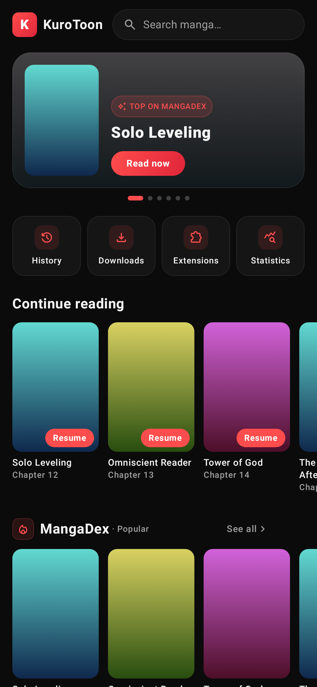
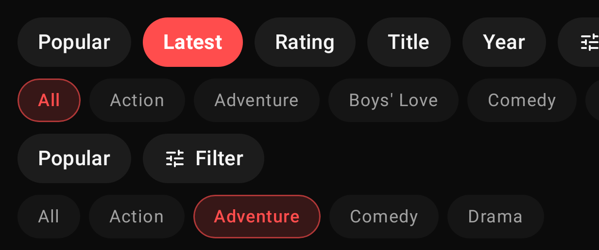
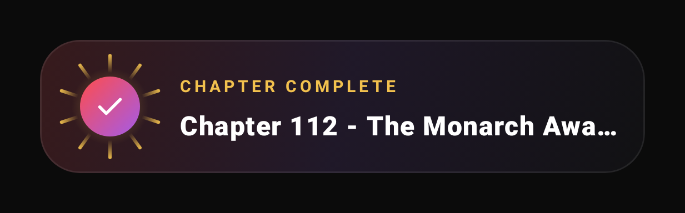
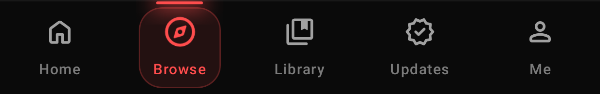
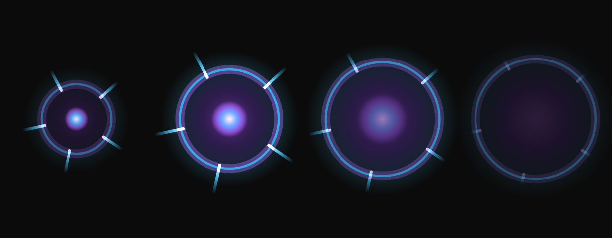

<div align="center">


# KuroToon

**Your manga. Your sources. One beautifully simple home.**

A private, local-first manga, manhwa and webtoon reader for Android, written in Kotlin and Jetpack Compose.

[](https://github.com/FAHTHIZ/Kurotoon/actions/workflows/build.yml)
[](LICENSE)


</div>

## Why KuroToon

- **Private by design.** No accounts, no analytics, no ads. Your library, history and downloads stay on your phone.
- **Your own library.** Add the sources you like, follow series, and get new chapters in Updates.
- **A home that feels alive.** A hero carousel of top titles, continue-reading cards and a row per source.
- **Built for long sessions.** Webtoon and paged modes, hands-free auto-scroll with ten speeds, and a small
  celebration each time you finish a chapter.
- **Smooth, not noisy.** Soft embers drift behind the UI and taps light up, at your screen's refresh rate.
  It all switches off with one toggle, follows the system "remove animations" setting, and does less on
  low-memory phones.
- **Everything else you'd expect.** Universal search across sources, genre and sort pills, offline downloads,
  tracker sync, source migration, backups and reading stats.

## Screenshots

<div align="center">

</div>

| Browse a source | Finished a chapter |
| --- | --- |
|  |  |
| **Navigation** | **Tap effect** |
|  |  |

These are rendered from the real Compose code by the screenshot tests (see [Development](#development)).

## Get started

1. Install the APK from the latest [Actions run](https://github.com/FAHTHIZ/Kurotoon/actions/workflows/build.yml)
   (or build it yourself, below).
2. Open **Browse → Extensions** and add a repository you trust.
3. Install a source, find a series and tap **Add to library**.

The [guides](docs/) cover [getting started](docs/getting-started.md), [your library](docs/library.md),
[tracking](docs/tracking.md), [storage](docs/storage.md), [moving between sources](docs/source-migration.md),
[privacy](docs/privacy.md) and [troubleshooting](docs/troubleshooting.md).

## Reader tips

- Tap the play button in the reader's bottom bar to start **auto-scroll**. Touching the screen pauses it;
  the speed slider lives in the reader settings under General.
- Volume keys can turn pages (reader settings → Controls).
- Long-press a page to save, share or set it as the cover.

## Development

Requirements: JDK 21 and the Android SDK.

```sh
./gradlew assembleDebug                 # debug APK in app/build/outputs/apk/debug/
./gradlew assembleRelease               # release APKs (debug-signed unless keystore.properties exists)
./gradlew spotlessApply                 # format
./gradlew :app:testDebugUnitTest -Pscreenshots --tests 'kurotoon.screenshots.*'
                                        # render UI screenshots to app/build/screenshots/
```

Every push to `main` is built by GitHub Actions and the APK is attached to the run.

## License

KuroToon is distributed under the Apache License 2.0. It is built on code from other Apache-2.0 open-source
Android readers; their copyright notices are kept in the source files. See [LICENSE](LICENSE).
