<div align="center">


# KuroToon

### Your manga. Your sources. One beautifully simple home.

A private, local-first reader for manga, manhwa and webtoons on Android.<br>
No accounts, no ads, no tracking: just your library, on your phone.

[](https://github.com/FAHTHIZ/Kurotoon/actions/workflows/build.yml)
[](https://github.com/FAHTHIZ/Kurotoon/releases/latest)
[](LICENSE)


**[Download](https://github.com/FAHTHIZ/Kurotoon/releases/latest)** ·
**[Features](#features)** ·
**[Screenshots](#screenshots)** ·
**[How it compares](#how-it-compares)** ·
**[Get started](#get-started)** ·
**[Guides](docs/)**


</div>

## Features

<table>
<tr>
<td width="33%" valign="top">

### A home that feels alive
A hero carousel, **Continue reading**, **New chapters**, **Out today**, "Because you read…", series you've
stalled on, and a row for every source and saved search. Pull to refresh; hide any row you don't want.

</td>
<td width="33%" valign="top">

### Release schedule
KuroToon learns which day each ongoing series usually updates and lays your library out as a week, the way
webtoon apps do. Home shows what's **out today**.

</td>
<td width="33%" valign="top">

### A reader for long sessions
Webtoon and paged modes, hands-free **auto-scroll** with ten speeds, a **chapter list inside the reader**,
a progress orb, time left in the chapter, and a small celebration when you finish one.

</td>
</tr>
<tr>
<td valign="top">

### A library that bends to you
Group it by **your categories, source, or publishing status**, or keep one list. **Hide categories** you
don't want on screen, filter by genre chips, show the **source on every cover**, and find duplicates.

</td>
<td valign="top">

### Browse the way each catalogue is built
Every source shows its own genres, themes and status as one-tap tags. Stack them, long-press to exclude,
**save the search** and pin it to Home. **Select several titles** and add them in one go.

</td>
<td valign="top">

### Private by design
No accounts, no analytics, no ads. Your library, history and downloads stay on your phone. Backups are
plain files you own.

</td>
</tr>
<tr>
<td valign="top">

### A shop you earn, not buy
Reading, daily visits and missions earn **Kuro Points**. Spend them on avatars, animated frames, themes,
particle colours and badges, or import your own [`.kpack` files](docs/shop-packs.md).

</td>
<td valign="top">

### Your reading, in numbers
A daily goal with a gentle reminder, a reading heatmap, your reading pace, and a **year in review**.

</td>
<td valign="top">

### Everything else you'd expect
Universal search across sources, offline downloads, tracker sync (AniList, MyAnimeList, Kitsu, MangaUpdates, Comick and more),
source migration, extension stores you can **switch on and off**, and backups.

</td>
</tr>
</table>

### New in this version

| | |
| --- | --- |
| **Release schedule & Out today** | A weekly view of when your series update, plus a Home row for today. |
| **Chapter list in the reader** | Tap the list button in the reader menu to jump to any chapter. |
| **Group library by** | Your categories, source, publishing status, or a single list. |
| **Hidden categories** | Keep a category out of sight; reveal it from the menu when you want it. |
| **Source on covers** | Library settings → Display → Source name. |
| **Select several in Browse** | Menu → Select several, tap covers, Add to library. |
| **Long-press on Home** | Add or remove any Home cover from your library without opening it. |
| **Switch stores off** | Turn an extension store off without deleting it. |

The full list is in the [changelog](CHANGELOG.md).

## Screenshots

<div align="center">

| Release schedule | Out today on Home | Duplicates finder |
| :---: | :---: | :---: |
| 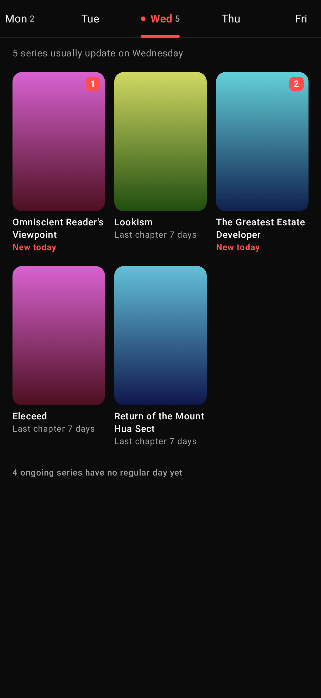 | 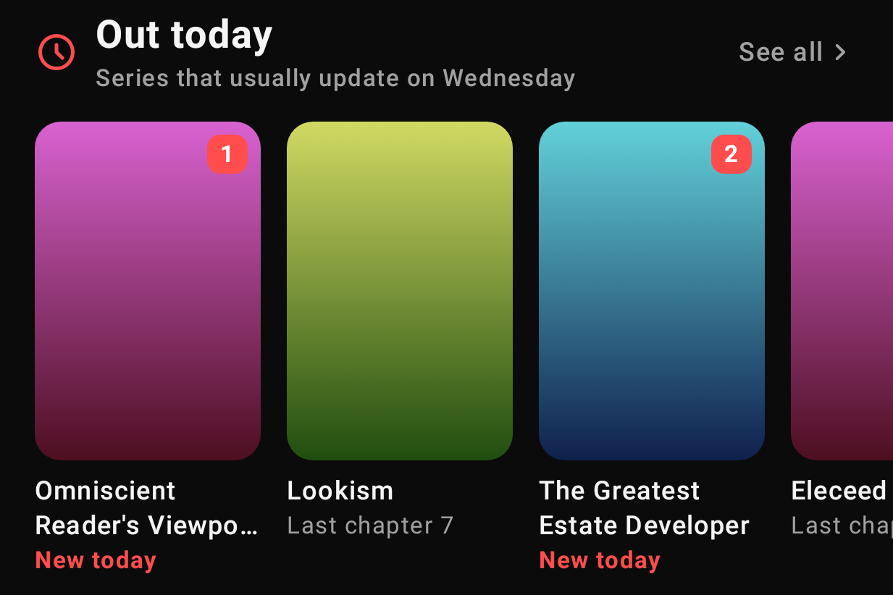<br><br>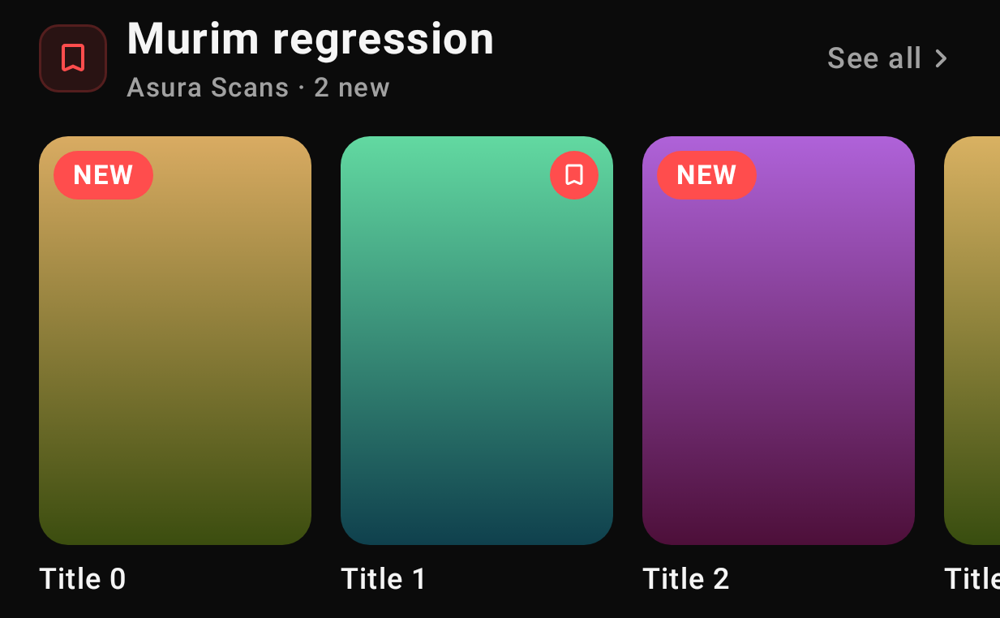 | 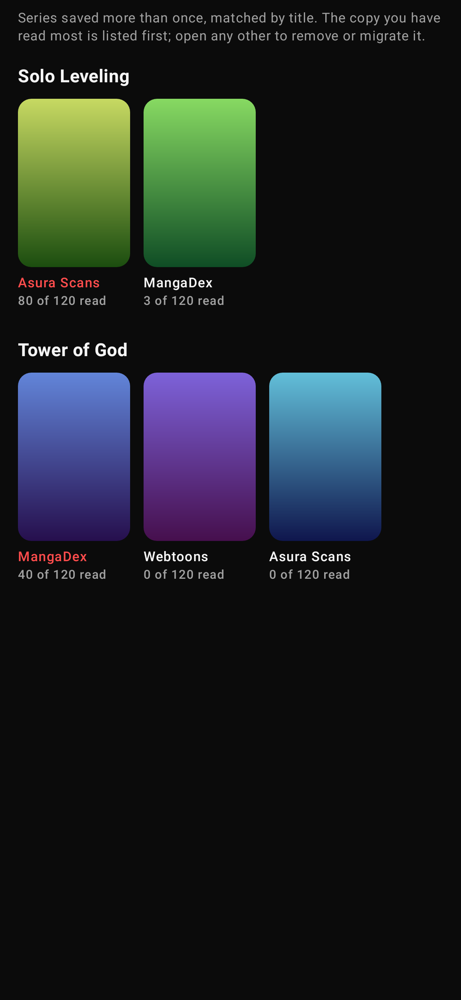 |
| **Browse a source** | **Finished a chapter** | **Your profile** |
|  |  | 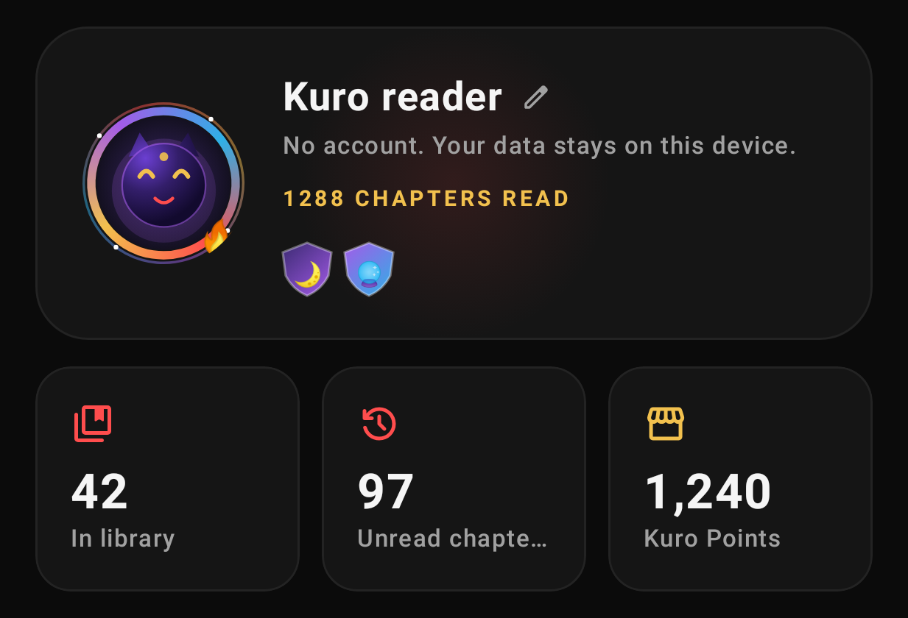 |
| **Kuro Shop** | **Daily missions** | **Your year in reading** |
| 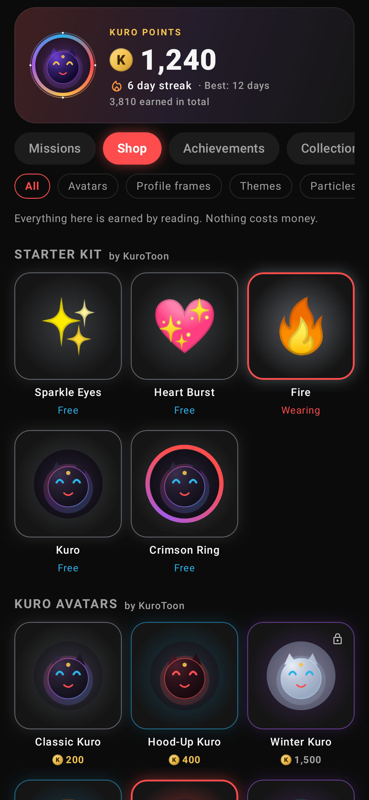 | 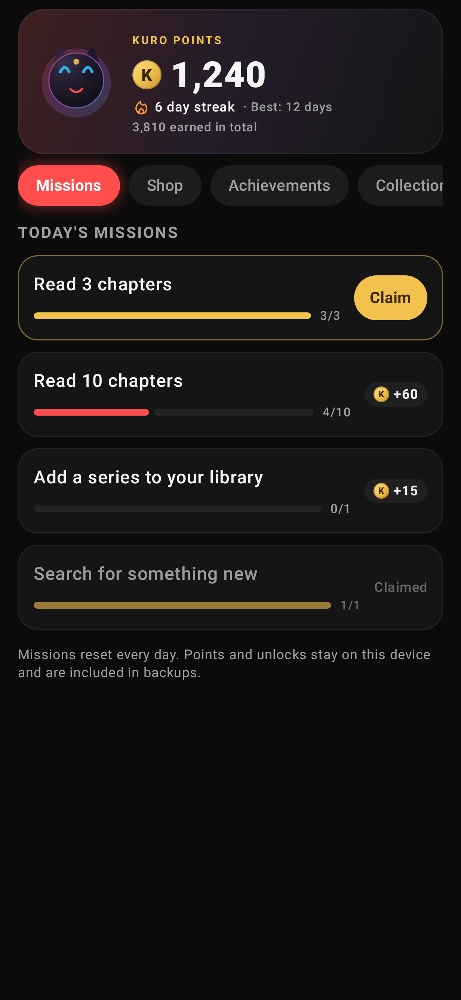 | 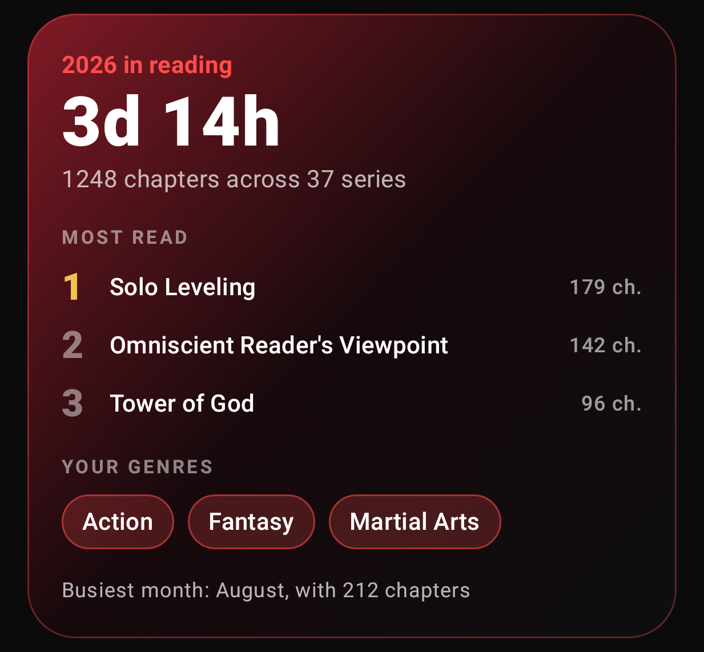 |
| **Progress on covers** | **Reading activity** | **Hidden tags** |
| 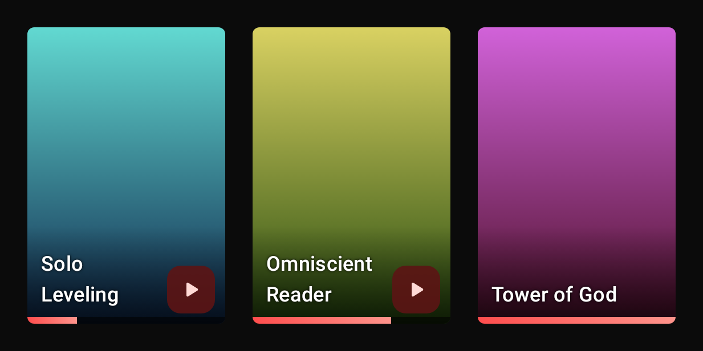 | 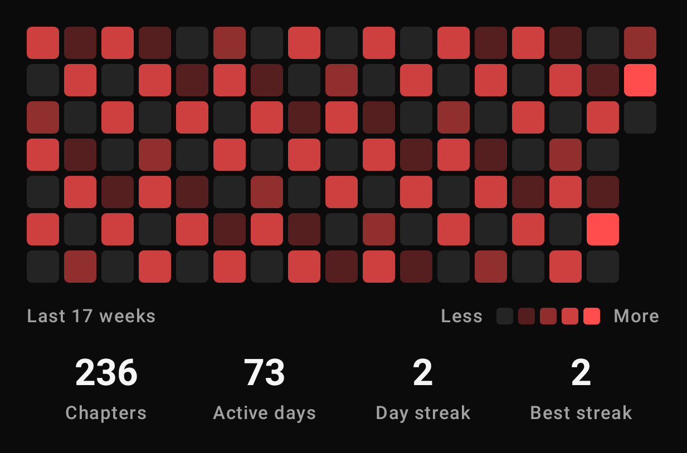 | 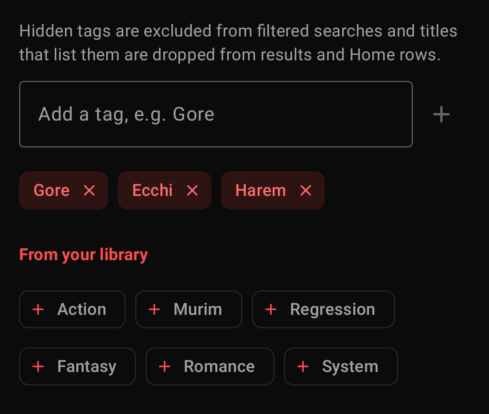 |
| **Find a source** | **Reading progress orb** | **Tap effect** |
| 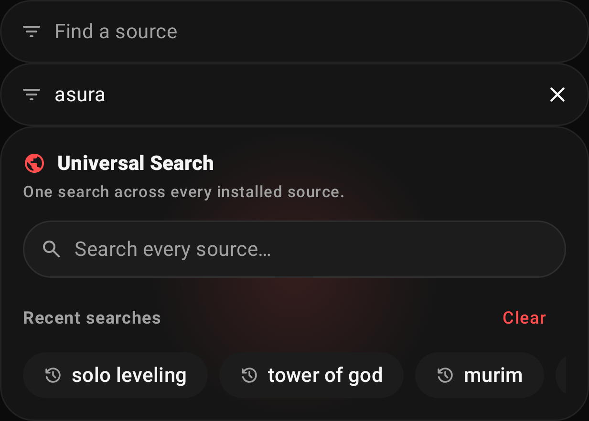 | 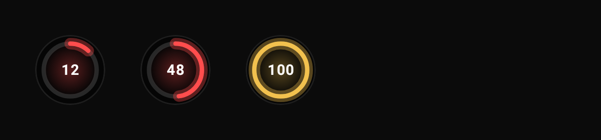 |  |

</div>

These are rendered from the real Compose code by the screenshot tests (see [Development](#development)).

## How it compares

KuroToon keeps everything that makes open-source readers great (any source, offline, private) and adds the
discovery and habit features people love in webtoon apps.

| | **KuroToon** | Open-source readers<br><sub>(e.g. Mihon)</sub> | Webtoon apps<br><sub>(e.g. WEBTOON)</sub> |
| --- | :---: | :---: | :---: |
| Read from any source through extensions | ✅ | ✅ | ❌ own catalogue |
| No account, no ads, no analytics | ✅ | ✅ | ❌ |
| Offline downloads, backups, tracker sync | ✅ | ✅ | ➖ |
| Home feed: continue reading, new chapters, picks | ✅ | ❌ | ✅ |
| Weekly release schedule and "out today" | ✅ | ❌ | ✅ |
| Saved searches pinned to Home | ✅ | ❌ | ❌ |
| Chapter list inside the reader | ✅ | ❌ | ✅ |
| Hands-free auto-scroll | ✅ | ❌ | ❌ |
| Group library by source or status | ✅ | ❌ | ➖ |
| Hidden categories, source badges, bulk add | ✅ | ❌ | ➖ |
| Daily goal, reading stats, year in review | ✅ | ➖ basic stats | ➖ |
| Rewards you earn by reading (no purchases) | ✅ | ❌ | ❌ coins are paid |

<sub>✅ yes · ➖ partly or not applicable · ❌ no. Based on each app's public features at the time of writing.</sub>

## Get started

1. **Install.** Grab the APK from the [latest release](https://github.com/FAHTHIZ/Kurotoon/releases/latest), or
   from the newest [Actions run](https://github.com/FAHTHIZ/Kurotoon/actions/workflows/build.yml) for the bleeding
   edge. Most phones want the `arm64-v8a` file; `universal` works everywhere.
2. **Add a repository.** Open **Browse → Extensions**, then the menu → **Extension stores**, tap **Add** and paste the index URL of a
   repository you trust (it ends in `index.min.json` or `index.pb`). Repo links of the form
   `tachiyomi://add-repo?url=…` open straight in KuroToon too.
3. **Install a source**, find a series and tap **Add to library**, or long-press its cover anywhere.
4. **Make Home yours.** Pull to refresh, save a search and pin it, or hide the rows you don't need.

The [guides](docs/) cover [getting started](docs/getting-started.md), [your library](docs/library.md),
[tracking](docs/tracking.md), [storage](docs/storage.md), [moving between sources](docs/source-migration.md),
[privacy](docs/privacy.md) and [troubleshooting](docs/troubleshooting.md).

## Reader tips

- Tap the **play button** in the reader's bottom bar to start auto-scroll. Touching the screen pauses it;
  the speed slider lives in the reader settings under General.
- Tap the **list button** to see every chapter and jump to any of them.
- Volume keys can turn pages (reader settings → Controls). While auto-scroll runs they change its speed instead.
- The orb in the corner shows how far through the chapter you are; tap it for the menu.
- Long-press a page to save, share or set it as the cover.

## Development

Requirements: JDK 21 and the Android SDK.

```sh
./gradlew assembleDebug                 # debug APK in app/build/outputs/apk/debug/
./gradlew assembleRelease               # release APKs (debug-signed unless keystore.properties exists)
./gradlew spotlessApply                 # format
./gradlew :app:testDebugUnitTest        # unit tests
./gradlew :app:testDebugUnitTest -Pscreenshots --tests 'kurotoon.screenshots.*'
                                        # render UI screenshots to app/build/screenshots/
KUROTOON_NETWORK_TESTS=1 ./gradlew :app:testDebugUnitTest --tests 'kurotoon.extension.*'
                                        # add a real extension repo and check its listing
```

Every push to `main` is built by GitHub Actions and the APK is attached to the run. The **QA emulator** workflow
boots an Android emulator, walks through user journeys (first run, adding a repo, installing a source, browsing,
reading) and records a screenshot of every step. Pushing a `v*` tag (or running the Release workflow by hand)
publishes a GitHub release with per-ABI APKs and checksums. Add the `SIGNING_KEY` (base64 keystore), `ALIAS`,
`KEY_STORE_PASSWORD` and `KEY_PASSWORD` secrets to sign them with your own key.

## License

KuroToon is distributed under the Apache License 2.0. It is built on code from other Apache-2.0 open-source
Android readers; their copyright notices are kept in the source files. See [LICENSE](LICENSE).
